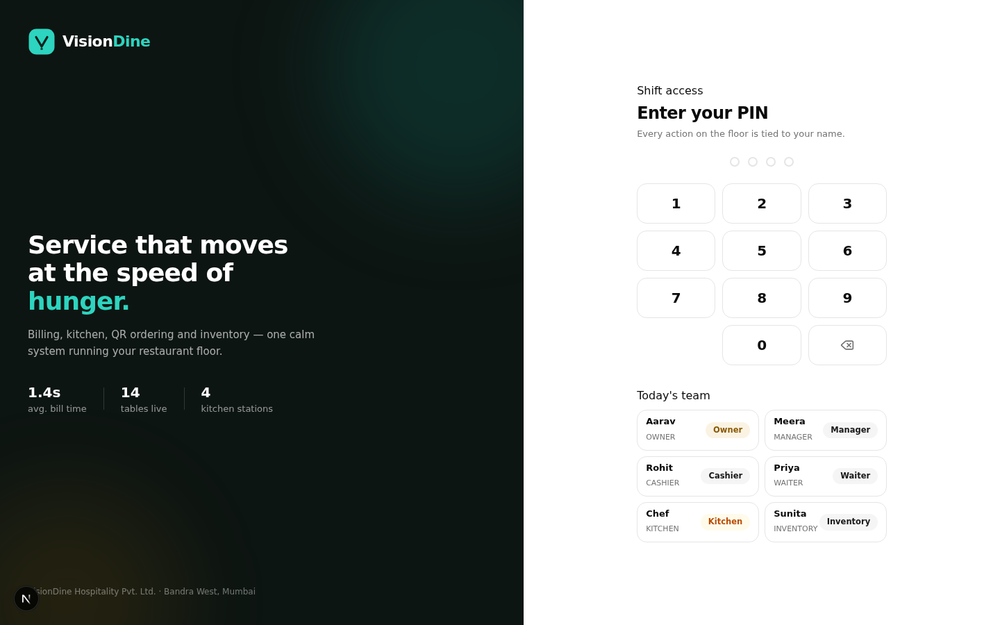
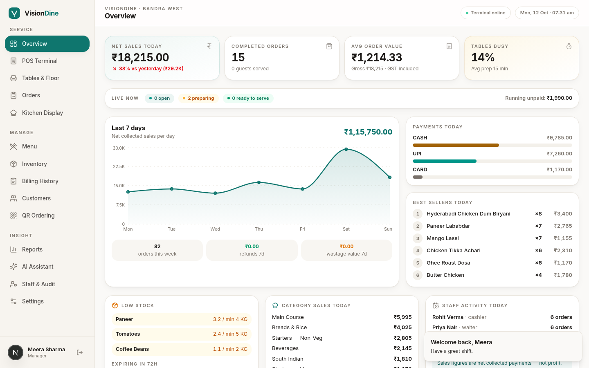
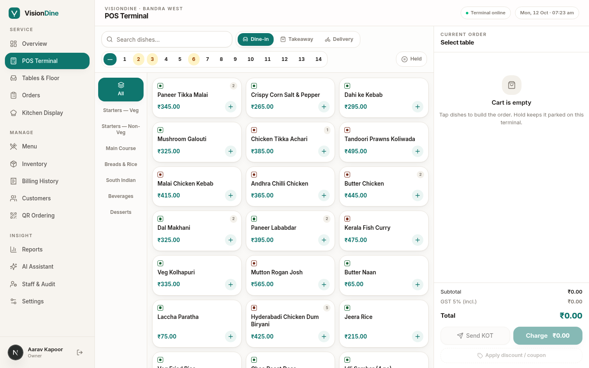
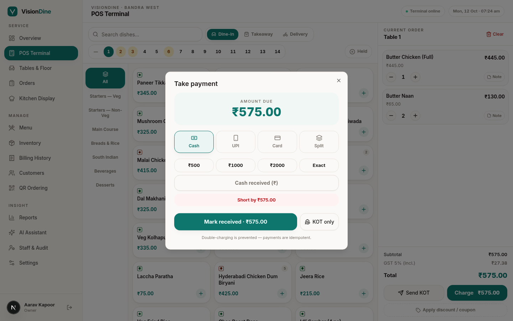
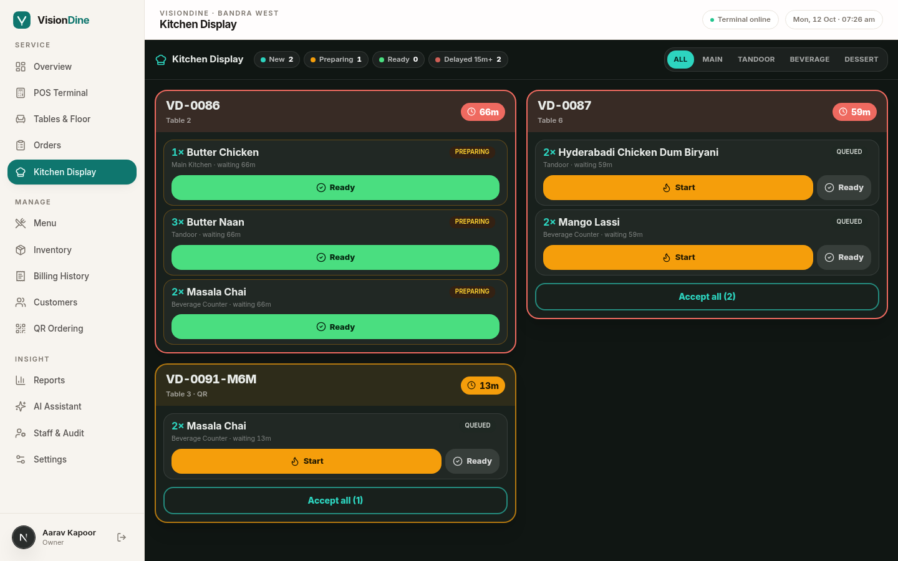
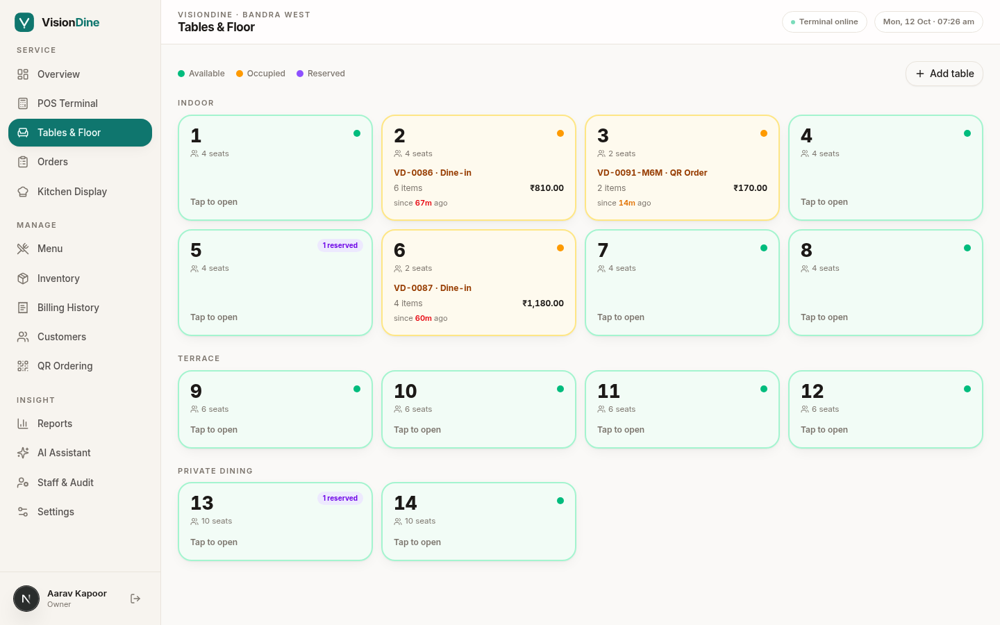
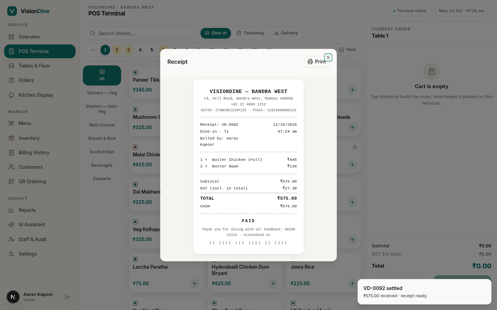
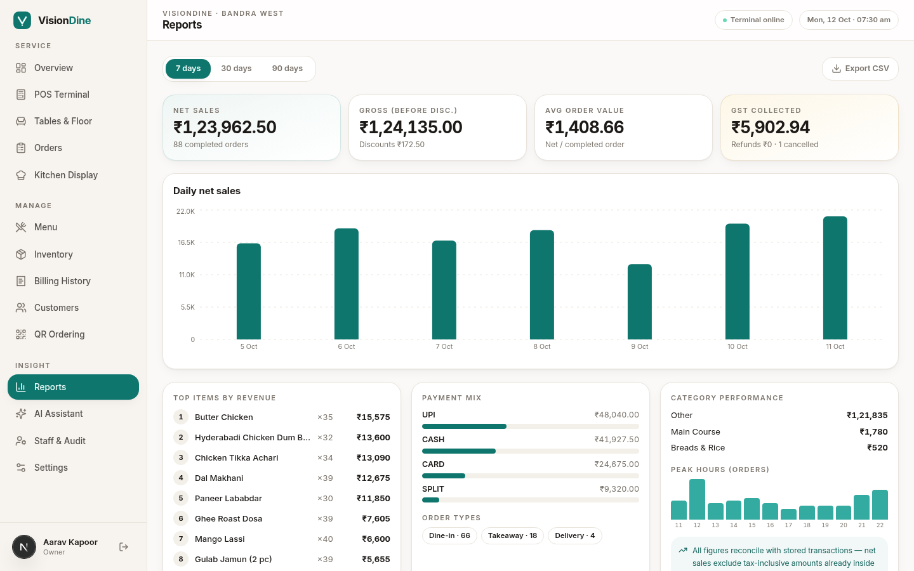
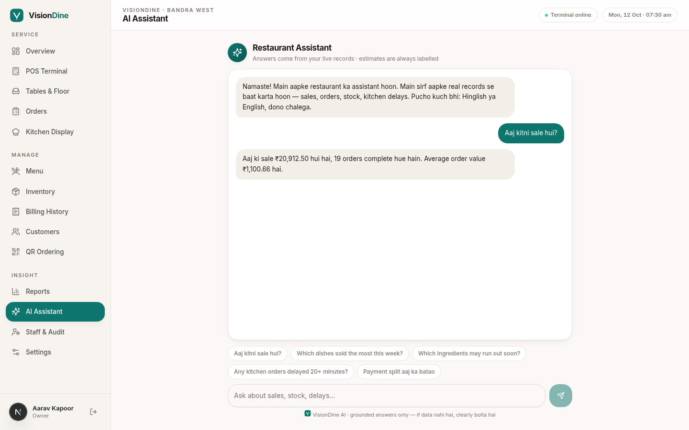
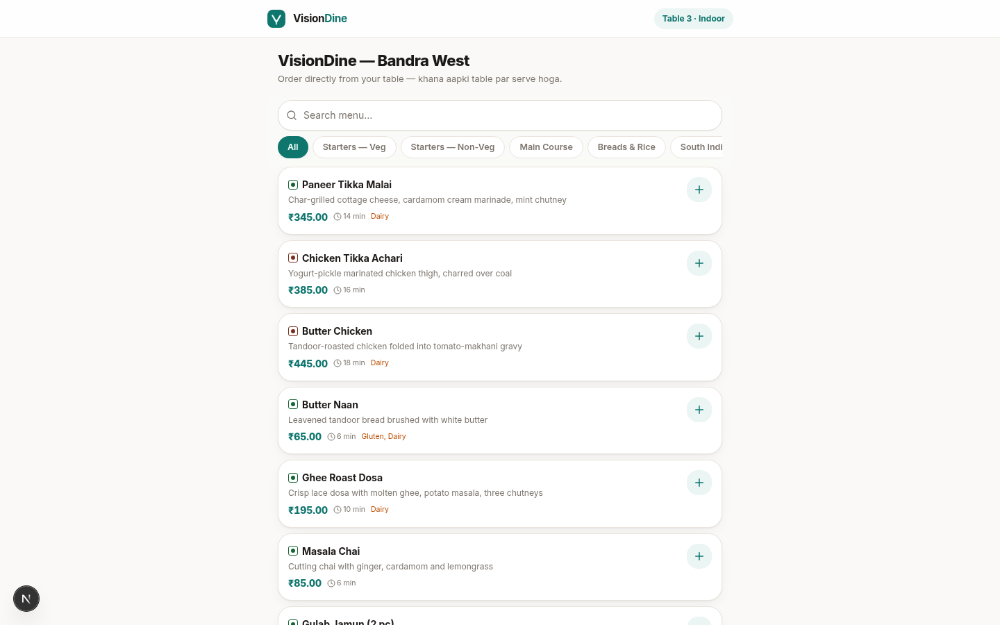

# VisionDine — AI Restaurant OS

A production-grade restaurant management & POS platform built for real Indian restaurant operations: fast billing, live kitchen display, QR table ordering, inventory auto-deduction, GST-compliant receipts, role-based staff access, and a grounded AI assistant that answers from your actual sales data.

Built with **Next.js 16 (App Router) · TypeScript · Prisma + SQLite · Tailwind CSS 4 · shadcn/ui · Recharts · Zustand**.

---

## Why it feels different

Most POS demos look like demos. VisionDine is designed like a product you'd actually ship — warm off-white canvas, deep teal + muted gold accents, Plus Jakarta Sans / Inter typography, tabular numerals for money, FSSAI-style veg marks, and a kitchen display that goes dark-and-focused because that's what a kitchen at 8pm needs. No decorative gradients, no fake glassmorphism, nothing that slows a cashier down.

## Feature map

| Area | What works |
|---|---|
| **POS Terminal** | Category rail, search, variants & add-ons, veg/non-veg filters, cart with live GST math, KOT print, hold & resume orders, coupon codes, line discounts (manager PIN) |
| **Tables & Floor** | 7 live states (available → occupied → order placed → preparing → ready to serve → payment pending → reserved), transfer, merge, reservations |
| **Kitchen Display (KDS)** | Dark operations screen, station routing, ticket timers with aging colors, New → Preparing → Ready → Served flow, bulk accept |
| **Billing & Payments** | Cash / UPI (QR on screen) / Card / **split payments**, idempotent settlement (replays can't double-charge), thermal-style receipt with GST breakdown |
| **QR Ordering** | Customer scans table QR → browses menu → places order → live status page with progress stepper + "call staff" / "get bill" |
| **Inventory** | Ingredients, per-item recipes, **auto stock deduction on settlement (deducted exactly once)**, purchases, wastage, stock ledger, low-stock & expiry alerts |
| **Menu Management** | CRUD with variants, add-ons, recipe linking, tax class, availability toggle, price snapshots preserved on old orders |
| **Staff & RBAC** | PIN login, 6 roles (Owner / Manager / Cashier / Waiter / Kitchen / Inventory), **server-enforced permissions** (403s, not hidden buttons), audit log of sensitive actions |
| **Refunds** | Manager/Owner only, mandatory reason, written to audit trail, stock-safe |
| **Analytics** | Revenue (clearly labelled as revenue, never "profit"), order counts, category mix, payment mix, 7-day trends, CSV export |
| **AI Assistant** | Ask "Aaj kitni sale hui?" or "Kaunsa item slow chal raha hai?" — answers are computed from your real database, with estimates labelled as estimates. POS runs fine with AI off |
| **Settings** | Restaurant profile, GST-inclusive/exclusive pricing mode, tax rates, UPI QR config, table management |

## Money math you can audit

- All amounts stored as **integer paise** — no floating-point drift
- GST computed server-side from configurable tax classes; inclusive pricing back-computes (₹575.00 @ 5% → ₹27.38 tax)
- Every order line stores the **price at time of sale**, so tomorrow's menu change never rewrites history
- Dashboard metrics reconcile against actual `Order` + `Payment` rows — no invented numbers

## Quick start

```bash
# 1. install
bun install

# 2. set database url
echo 'DATABASE_URL=file:./db/custom.db' > .env

# 3. create schema
bun run db:push

# 4. seed realistic demo data (32 menu items, 14 tables, staff, 7 days of orders)
bun run scripts/seed.ts

# 5. run
bun run dev
```

Open `http://localhost:3000`.

### Demo logins (PIN pad)

| Name | Role | PIN |
|---|---|---|
| Aarav Kapoor | Owner | `1001` |
| Meera Sharma | Manager | `2002` |
| Rohit Verma | Cashier | `3003` |
| Priya Nair | Waiter | `4004` |
| Chef Balwant | Kitchen | `5006` |
| Sunita Rao | Inventory | `6007` |

> Try: log in as Cashier, open a dine-in order on POS, fire the KOT, watch it appear on KDS (log in again as Kitchen), mark it Ready, settle with cash or split payment, and print the receipt. Then scan a table QR (Settings → QR) to order as a customer.

### Customer QR views

- Ordering: `/?qr=menu&table=5`
- Live order status: `/?qr=status&orderNo=VD-xxxxxx`

## Architecture notes

```
src/
  app/page.tsx            # single-page app shell (login + all staff views + QR views)
  app/api/                # 16 route files — auth, menu, orders, payments, kitchen,
                          # inventory, analytics, staff, customers, settings, public(QR), assistant
  components/visiondine/  # 17 view components + design-system primitives
  lib/
    money.ts              # paise-integer tax engine (inclusive/exclusive GST)
    session.ts            # HMAC-signed httpOnly session cookie + server-side RBAC
    receipt.ts            # thermal receipt renderer
    db.ts                 # prisma client
prisma/schema.prisma      # Staff, Category, MenuItem, Variant, Addon, Table, Reservation,
                          # Order, OrderItem, Payment, Refund, Ingredient, RecipeLine,
                          # StockMovement, Customer, Coupon, Setting, AuditLog
scripts/seed.ts           # realistic Indian restaurant seed
scripts/e2e.ts            # API smoke test: tax math, idempotency, RBAC, KDS flow, QR order
```

**Payments:** cash / card entries are recorded as completed-tender records; UPI shows a configurable QR for the customer to pay and is confirmed by staff. Gateway integrations (e.g. Razorpay) should only ever mark success after **server-side verification / webhook** — never on a client click. Settlement is idempotent via a unique `idempotencyKey` on payments.

**Real-time:** KDS and floor plan poll every few seconds over React Query — deliberately simple and resilient behind flaky venue Wi-Fi.

## Verified end-to-end

A full API smoke suite (`bun run scripts/e2e.ts`) covers: inclusive-GST math, manager-PIN discounts, KDS transitions, payment idempotency (replay returns duplicate, not double charge), single inventory deduction per settlement, RBAC 403s, QR ordering flow, and a grounded AI answer with real figures.

## Screenshots

| | |
|---|---|
|  |  |
|  |  |
|  |  |
|  |  |
|  |  |

---

Built as a complete, working restaurant OS — not a mockup.
